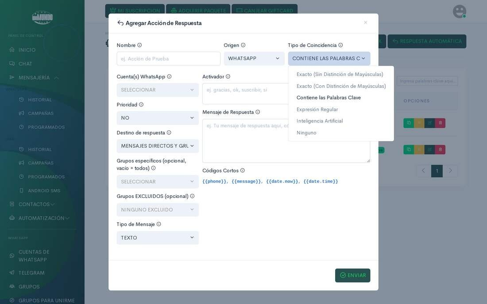
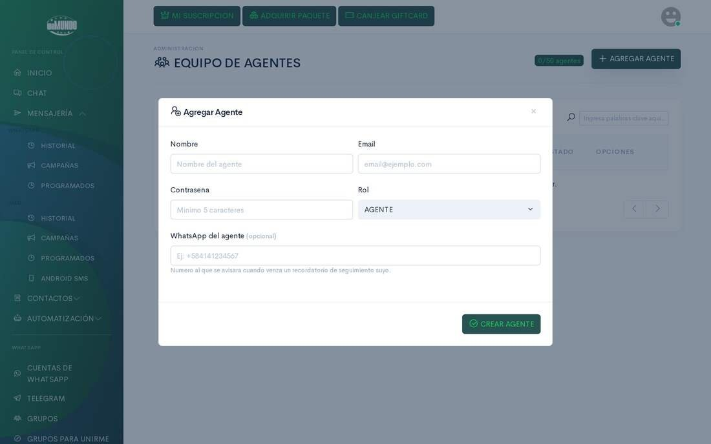
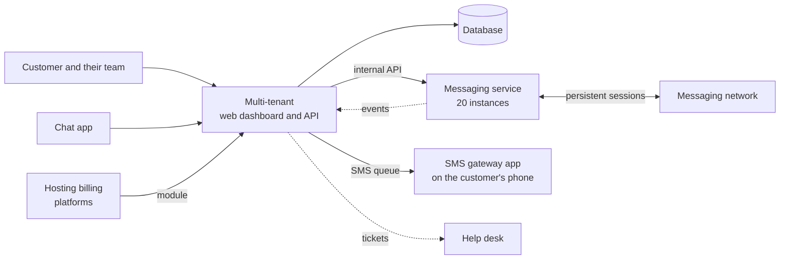

# WaMundo

> A multi-tenant business messaging platform. From one dashboard, a business
> runs bulk and scheduled sends, handles customers as a team, automates replies
> with artificial intelligence and sends SMS through its own SIM.

**Status:** in production at [wamundo.com](https://wamundo.com) ·
**Proprietary system** by Kusarive Solutions LLC ·
[Versión en español](README.md) ·
[Presentation page](https://rjblancos.github.io/wamundo-showcase/) ·
**[Download the presentation as PDF](presentacion/WaMundo-presentacion.pdf)** (13 slides, in Spanish)

---

## The problem

A business that sells over messaging ends up with several lines, a team
answering from different phones, and hundreds of groups and contacts to write
to every day. By hand it doesn't scale. The tools that do it are usually in
English, charge per message or need integrations a small business can't build.

WaMundo puts it all in one dashboard, in Spanish. The business connects its
lines and schedules its sends. Its team answers from the web or from a phone,
and the AI handles the repetitive questions around the clock.

## What it does

- **Bulk and scheduled sending.** To hundreds of groups and contacts, by day of
  the week and at several times a day, with automatic staggering between
  recipients and load sharing across lines.
- **Personalized messages.** Variables for the contact's name, the date or the
  time, and text variations so no two sends are identical.
- **Up to 20 lines per customer**, managed from a single dashboard.
- **Multi-agent inbox.** Conversations with labels, internal notes, quick
  replies, agent assignment and open, pending and closed states.
- **Team roles.** Agents, supervisors and administrators, with a contact center
  and metrics.
- **Automation.** Automatic replies by keyword, regular expression or
  artificial intelligence, and visual multi-step flows.
- **Sales AI per line.** It answers the business's customers, quotes prices and
  hands over to a person when needed.
- **Advanced messaging features.** Polls, reactions, mentioning a whole group,
  editing and deleting sent messages, group management, statuses and channels.
- **SMS through the customer's own SIM.** An app turns any phone into a sending
  gateway: pick the SIM, it keeps sending with the screen off and restarts on
  its own after a power cut.
- **Mobile chat app**, with several lines in one inbox and conversations
  encrypted on the phone.
- **API and webhooks** so the customer's own system can send and receive
  messages.
- **Module for hosting billing platforms.** It notifies each customer of their
  invoices, payments and tickets over messaging, from each brand's own line.
- **Public user manual** of more than 200 pages, with a screenshot of every
  screen.

## Benefits

| For the business | |
|---|---|
| **One dashboard for everything** | Sending, support, automation and SMS in one place, in Spanish. |
| **The team works together** | Every conversation has an owner, a label and a state. Nobody answers twice and nobody is left without a reply. |
| **Open around the clock** | The AI handles the repetitive questions and leaves people what really needs them. |
| **SMS without contracts** | It sends through its own line, with no SMS provider to sign up with. |
| **Free to try** | 30-day trial, and plans from USD 11.99 a month. |

| For the platform operator | |
|---|---|
| **Multi-tenant by design** | Each customer has their own lines, contacts, team and automations, isolated from the rest. |
| **Messaging scales on its own** | Sessions live in a dedicated service spread over 20 instances, independent of the web dashboard. |
| **Connected support** | Tickets opened from the dashboard reach the company's help desk, and replies flow back to the customer. |

## Screenshots

The interface is in Spanish.

| Public home page | Automatic replies |
|---|---|
|  |  |

| Agent team | Inbox on mobile |
|---|---|
|  |  |

The dashboard screenshots come from the public manual, on a demo account.

## Architecture

The web dashboard is stateless. Messaging sessions, which must stay alive
continuously, are kept by a separate service written in Go. That service is
spread over 20 instances, and each account is pinned to one of them. Incoming
messages flow back to the dashboard as events.

## Technical guarantees

| Area | What the system guarantees |
|---|---|
| **Session continuity** | Sessions recover on their own at startup. Re-linking a line creates a new session without cutting the working one: the old one is only retired once the new one is connected. |
| **No send lost on restart** | When shutting down, an instance stops taking work and returns the messages it hasn't started to the queue, so another one sends them. |
| **Sending that protects the line** | Staggering between recipients, pauses that vary by plan, and load sharing across several lines. |
| **Security** | CSRF protection on the dashboard, key-based API access, an HMAC-signed support bridge and an encrypted local cache in the mobile app. |
| **Quality** | Automated tests for the messaging service: contact identity, events, voice notes, queue draining and re-linking. |

## Built with

| Language | Where | Approximate size |
|---|---|---|
| **PHP** | Web dashboard, API, automation, AI and billing | 75,000 lines |
| **HTML, CSS and JavaScript** | Templates and interface for the dashboard and public site | 42,000 lines |
| **Go** | The messaging service, with its tests | 12,000 lines |
| **Dart** | The two mobile apps and their shared core | 14,900 lines |
| **Kotlin** | The native SMS gateway service | 1,000 lines |
| **PHP** | The module for hosting billing platforms | 11,800 lines |
| **SQL** | The database, with per-tenant isolation | |

GitHub's language bar only measures the files in this repository, which is
documentation.

## Results

Real figures read from the production database on 27-Oct-2026:

- **2.69 million messages sent** successfully since November 2025.
- **637,000 messages sent** in the last 30 days.
- **2.6 million messages received** and handled in the inbox.
- **129 connected lines** across 71 customers.

## Contact

Rafael Blanco, for Kusarive Solutions LLC

- Web: [wamundo.com](https://wamundo.com)
- Email: info@wamundo.com
- WhatsApp: [+1 317 779 0136](https://wa.me/13177790136)
- Presentation: [13-slide PDF](presentacion/WaMundo-presentacion.pdf) (in Spanish)

## What's new

- **27-Oct-2026** · Showcase published, with a downloadable PDF presentation.

Full log: [CHANGELOG.md](CHANGELOG.md).

© 2026 Kusarive Solutions LLC. See [LICENSE](LICENSE).
