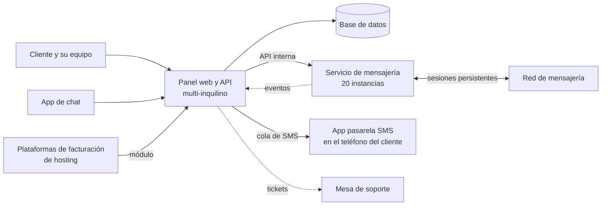

# WaMundo

> Plataforma multi-inquilino de mensajería para negocios. Desde un mismo panel
> se hacen envíos masivos y programados, se atiende en equipo, se automatizan
> respuestas con inteligencia artificial y se envían SMS por la SIM propia del
> cliente.

**Estado:** en producción en [wamundo.com](https://wamundo.com) ·
**Sistema propietario** de Kusarive Solutions LLC ·
[English version](README.en.md) ·
[Página de presentación](https://rjblancos.github.io/wamundo-showcase/)

---

## Qué resuelve

Un negocio que vende por mensajería acaba con varias líneas, un equipo que
contesta desde teléfonos distintos y cientos de grupos y contactos a los que
escribir cada día. A mano no escala, y las herramientas que lo hacen suelen
estar en inglés, cobrar por mensaje o pedir integraciones que un comercio
pequeño no puede montar.

WaMundo lo reúne todo en un solo panel en español. El negocio conecta sus
líneas y programa sus envíos. Su equipo atiende desde la web o desde el móvil,
y la IA contesta lo repetitivo las 24 horas.

## Qué hace

- **Envíos masivos y programados.** A cientos de grupos y contactos, por días de
  la semana y varios horarios, con escalonamiento automático entre destinos y
  reparto entre líneas.
- **Mensajes personalizados.** Variables con el nombre del contacto, la fecha o
  la hora, y variaciones de texto para que ningún envío sea idéntico a otro.
- **Hasta 20 líneas por cliente**, gestionadas desde un único panel.
- **Bandeja multi-agente.** Conversaciones con etiquetas, notas internas,
  respuestas rápidas, reparto entre agentes y estados abiertas, pendientes y
  cerradas.
- **Equipo con roles.** Agentes, supervisores y administradores, con centro de
  contacto y métricas.
- **Automatización.** Respuestas automáticas por palabra clave, expresión
  regular o inteligencia artificial, y flujos visuales de varios pasos.
- **IA de ventas por línea.** Atiende a los clientes del negocio, informa
  precios y pasa a una persona lo que lo necesita.
- **Funciones avanzadas de mensajería.** Encuestas, reacciones, menciones a todo
  un grupo, edición y borrado de mensajes enviados, gestión de grupos, estados y
  canales.
- **SMS con la SIM propia.** Una app convierte cualquier teléfono en pasarela de
  envío: se elige la SIM, sigue enviando con la pantalla apagada y arranca sola
  tras un corte de luz.
- **App de chat para el móvil**, con varias líneas en una bandeja y las
  conversaciones cifradas en el teléfono.
- **API y webhooks** para que el sistema del cliente envíe y reciba mensajes.
- **Módulo para plataformas de facturación de hosting.** Avisa a cada cliente de
  sus facturas, pagos y tickets por mensajería, con la línea de cada marca.
- **Manual de usuario público** de más de 200 páginas, con capturas de cada
  pantalla.

## Beneficios

| Para el negocio | |
|---|---|
| **Un solo panel para todo** | Envíos, atención, automatización y SMS en el mismo sitio y en español. |
| **Su equipo trabaja junto** | Cada conversación tiene dueño, etiqueta y estado. Nadie contesta dos veces ni se queda nadie sin respuesta. |
| **Atiende las 24 horas** | La IA contesta lo repetitivo y deja a las personas lo que de verdad las necesita. |
| **SMS sin contratos** | Envía por su propia línea, sin contratar un proveedor de SMS. |
| **Lo prueba gratis** | 30 días de prueba, y planes desde 11,99 USD al mes. |

| Para el operador de la plataforma | |
|---|---|
| **Multi-inquilino desde el diseño** | Cada cliente tiene sus líneas, contactos, equipo y automatizaciones, aislados del resto. |
| **El servicio de mensajería escala por separado** | Las sesiones viven en un servicio propio repartido en 20 instancias, independiente del panel web. |
| **Soporte conectado** | Los tickets del panel llegan a la mesa de soporte de la empresa, y las respuestas vuelven al cliente. |

## Capturas

| Portada pública | Respuestas automáticas |
|---|---|
|  |  |

| Equipo de agentes | Bandeja en el móvil |
|---|---|
|  |  |

Las capturas del panel salen del manual público, en una cuenta de demostración.

## Arquitectura

El panel web no tiene estado. Las sesiones de mensajería, que deben vivir de
forma continua, las mantiene un servicio aparte en Go. Ese servicio está
repartido en 20 instancias, y cada cuenta está fijada a una de ellas. Los
mensajes entrantes vuelven al panel como eventos.

## Garantías técnicas

| Área | Qué garantiza el sistema |
|---|---|
| **Continuidad de las sesiones** | Las sesiones se recuperan solas al arrancar. Revincular una línea crea una sesión nueva sin cortar la que funciona: la vieja solo se retira cuando la nueva ya está conectada. |
| **Ningún envío perdido al reiniciar** | Al apagarse, una instancia deja de tomar trabajo y devuelve a la cola los mensajes que aún no empezó, para que otra los envíe. |
| **Envíos que cuidan la línea** | Escalonamiento entre destinos y pausas variables según el plan, y reparto entre varias líneas. |
| **Seguridad** | Protección CSRF en el panel, acceso a la API por clave, puente de soporte firmado con HMAC y caché local cifrada en la app móvil. |
| **Calidad** | Pruebas automáticas del servicio de mensajería: identidad de contactos, eventos, notas de voz, drenado de la cola y revinculación. |

## Construido con

| Lenguaje | Dónde | Tamaño aproximado |
|---|---|---|
| **PHP** | Panel web, API, automatizaciones, IA y facturación | 75.000 líneas |
| **HTML, CSS y JavaScript** | Plantillas e interfaz del panel y del sitio público | 42.000 líneas |
| **Go** | El servicio de mensajería, con sus pruebas | 12.000 líneas |
| **Dart** | Las dos apps móviles y su núcleo compartido | 14.900 líneas |
| **Kotlin** | El servicio nativo de la pasarela SMS | 1.000 líneas |
| **PHP** | El módulo para plataformas de facturación de hosting | 11.800 líneas |
| **SQL** | La base de datos, con aislamiento por inquilino | |

La barra de lenguajes de GitHub mide solo los ficheros de este repositorio, que
es documentación.

## Resultados

Cifras reales leídas de la base de datos de producción el 27-oct-2026:

- **2,69 millones de mensajes enviados** con éxito desde noviembre de 2025.
- **637.000 mensajes enviados** en los últimos 30 días.
- **2,6 millones de mensajes recibidos** y gestionados en la bandeja.
- **129 líneas conectadas** por 71 clientes.

## Contacto

Rafael Blanco, para Kusarive Solutions LLC

- Web: [wamundo.com](https://wamundo.com)
- Correo: info@wamundo.com
- WhatsApp: [+1 317 779 0136](https://wa.me/13177790136)

© 2026 Kusarive Solutions LLC. Ver [LICENSE](LICENSE).
